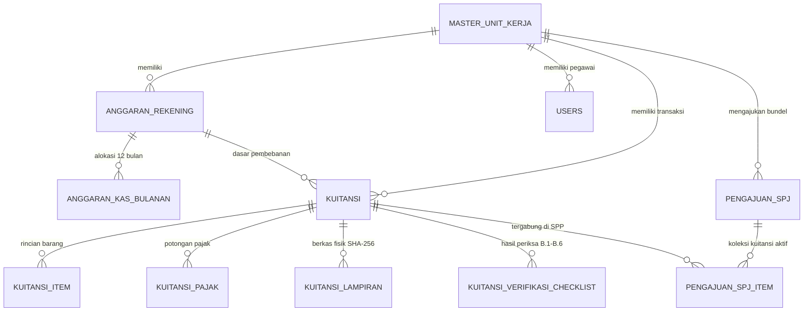

# 📊 Laporan Progres Pengembangan Backend: SI-TALITI v2.0

> **Sistem Informasi Tata Kelola, Asistensi, dan Verifikasi Akuntabilitas SPJ**  
> **Wilayah Implementasi:** Kecamatan Tarogong Kidul & 5 Kelurahan (Kabupaten Garut)  
> **Periode:** Siklus Anggaran Perubahan Tahun 2026  
> **Penyusun:** Developer 1 (Backend Lead)  
> **Status:** ✅ **Phase 1 s.d. Phase 6 Selesai 100% (Semua Modul Terverifikasi Penuh)**

---

## 1. Ringkasan Eksekutif (Executive Summary)

Pengembangan core engine dan sistem backend SI-TALITI v2.0 telah berhasil diselesaikan secara komprehensif mengadopsi pendekatan **Engine-First** dan **Test-Driven Development (TDD)**. 

Seluruh aspek tata kelola keuangan daerah—mulai dari otomasi kepatuhan pajak multi-regulasi (PMK 59/2022, UU HKPD 1/2022, PP 80/2010), tata kelola pagu kas RAK 12 bulan (Rp 14,25 Miliar), pencegahan nota kembar berbasis SHA-256, workspace verifikasi split-screen dengan 35 butir checklist dinamis dan pelacakan SLA 2 hari kerja, hingga pembundelan Two-Tier Settlement berproteksi anti-klaim ganda dan verifikasi QR Code publik—telah beroperasi secara penuh dan teruji dengan **73 automated tests (268 assertions) 100% HIJAU**.

---

## 2. Metrik Kualitas & Performa Sistem

| Indikator | Nilai Terukur | Keterangan |
| :--- | :---: | :--- |
| **Total Automated Tests** | **73 Tests (268 Assertions)** | 100% Pass pada unit & feature suite |
| **Durasi Eksekusi Test Suite** | **~2.9 detik** | Sangat cepat dan deterministik via SQLite memory/Sail |
| **Total Pagu RAK Dikelola** | **Rp 14.252.126.458** | Tersebar di 6 unit kerja & 39 subkegiatan |
| **Jumlah Rekening Belanja Leaf** | **132 Rekening** | Masing-masing memiliki alokasi 12 bulan (1.584 baris kas) |
| **Kecepatan Impor Master RAK** | **0.2 detik (< 30 MB RAM)** | Menggunakan native streaming `ZipArchive` & `XML` |
| **Drift Pembulatan Pajak** | **Rp 0.00 (Zero-Drift)** | Rumus: $\text{DPP} = \text{round}(\text{Bruto}/1.11)$, $\text{PPN} = \text{Bruto}-\text{DPP}$ |
| **Kepatuhan Gaya Kode (Linting)** | **0 Warning / Error** | Standar PSR-12 & Laravel Pint |

---

## 3. Rincian Capaian per Fase Pengembangan

### Phase 1: Statutory Tax Engine (`mod-tax-engine`)
- **Tujuan:** Menghilangkan risiko temuan BPK terkait salah hitung pajak daerah vs pusat dan *rounding drift* Rp 1.
- **Implementasi:**
  - Belanja ATK (B.1) $\le \text{Rp } 2.000.000$ bebas pungut PPN dan PPh 22 sesuai PMK 59/2022.
  - Belanja Makan Minum Rapat/Katering (B.2) memungut Pajak Barang dan Jasa Tertentu (PBJT) 10% dan mutlak membebaskan PPN pusat 11% sesuai UU HKPD No. 1/2022.
  - Honorarium ASN (B.3) memungut PPh 21 berbasis Golongan (Gol I/II 0%, III 5%, IV 15%, Non-ASN 5%) sesuai PP 80/2010.
  - Surcharge penalti tarif 100% bagi rekanan yang tidak memiliki NPWP (PPh 22 dari 1.5% menjadi 3.0%, PPh 23 dari 2% menjadi 4%).
  - Bea Meterai Rp 10.000 otomatis aktif pada belanja $> \text{Rp } 5.000.000$ tanpa memotong neto rekanan.
  - Invarian matematis mutlak: $\text{Nominal Neto} = \text{Nominal Bruto} - \sum \text{Pajak Dipungut}$.

### Phase 2: Budget Reservation Engine (`mod-budget-reservation`)
- **Tujuan:** Menjaga agar pengeluaran kuitansi tidak melebihi kuota RAK bulanan dan akumulasi carry-over.
- **Implementasi:**
  - Kalkulasi kuota dinamis:
    $$\text{Pagu Tersedia Bulan } n = \sum_{m=1}^{n-1} (\text{Alokasi}_m - \text{Realisasi}_m - \text{Terkunci}_m) + \text{Alokasi}_n - \text{Realisasi}_n - \text{Terkunci}_n$$
  - Otomatis mengunci bulan masa depan ($n > \text{activeMonth}$) berstatus `LOCKED_FUTURE` dengan sisa 0.
  - Penolakan nominal $\le 0$ dan nominal melebihi sisa pagu via `PaguOverlimitException`.
  - Proteksi underflow pada saat pelepasan pagu kuitansi.

### Phase 3: RAK Master Ledger & High-Speed Streaming Importer (`mod-budget-rak`)
- **Tujuan:** Mengakomodasi 132 rekening leaf dan alokasi kas bulanan dari file resmi RAK Perubahan 2026.
- **Implementasi:**
  - Migrasi database 6 unit kerja, `anggaran_rekening`, dan `anggaran_kas_bulanan` (12 baris kas per rekening).
  - Service `RakImporterService` berbasis native PHP `ZipArchive` dan `SimpleXMLElement` yang mampu membaca file XLSX secara *streaming* dalam 0.2 detik tanpa pembengkakan memori.
  - Artisan Command `php artisan sitaliti:import-rak` untuk otomatisasi migrasi dan seeding data.
  - Akurasi pagu tepat Rp 14.252.126.458.

### Phase 4: Atomic Receipt Pipeline & SHA-256 Anti-Duplication (`mod-receipt-core`)
- **Tujuan:** Menyediakan API transaksi kuitansi dengan proteksi mutlak terhadap kecurangan nota fiktif ganda.
- **Implementasi:**
  - Skema tabel `kuitansi`, `kuitansi_item`, `kuitansi_pajak`, dan `kuitansi_lampiran` dengan check constraint keseimbangan:
    `ALTER TABLE kuitansi ADD CONSTRAINT chk_keseimbangan CHECK (nominal_neto = nominal_bruto - total_pajak)`.
  - **Deteksi Nota Kembar Sinkron:** Saat unggah berkas, sistem menghitung hash SHA-256 berkas secara instan. Jika berkas dengan hash identik sudah ada pada rekening belanja yang sama, request ditolak HTTP 422 `DUPLICATE_RECEIPT_ATTACHMENT`.
  - Transisi submit ke PPTK yang mengunci pagu RAK secara atomic (`lockForUpdate`).

### Phase 5: Verification Workspace & SLA Loopback Tracking (`mod-verification-workspace`)
- **Tujuan:** Memfasilitasi tim verifikator memeriksa berkas secara split-screen, mencatat SLA revisi, dan mengelola state persetujuan.
- **Implementasi:**
  - Seeder 35 butir checklist dinamis Form Pembinaan Kecamatan (B.1 ATK, B.2 Mamin, B.3 Honor, B.4 Perjadin, B.5 Jasa, B.6 Modal).
  - Siklus State Machine:
    - `VERIFIED`: Status menjadi `LOLOS_VERIFIKASI`, menerbitkan `qr_token` UUID untuk Lembar Kendali.
    - `REVISION_MINOR`: Menghitung batas waktu SLA 2 hari kerja efektif via `Carbon::now()->addWeekdays(2)` (otomatis melompati hari Sabtu & Minggu).
    - `REVISION_MAJOR`: Otomatis memulihkan pagu anggaran yang terkunci ke tabel `anggaran_kas_bulanan`.

### Phase 6: Two-Tier Settlement Bundling & Public QR Verification (`mod-settlement-bundling` & `mod-control-sheet-qr`)
- **Tujuan:** Pengesahan berkas SPP-GU/TU/LS (Tier 2) bebas klaim ganda, pencatatan SP2D, dan verifikasi QR Code publik.
- **Implementasi:**
  - Pembundelan kuitansi lolos verifikasi ke dalam tabel `pengajuan_spj` dan `pengajuan_spj_item`.
  - **Proteksi Anti-Klaim Ganda ANSI SQL:** Kolom *stored generated* `active_kuitansi_id` dengan unique constraint memastikan kuitansi yang sama tidak bisa dimasukkan ke dua draf SPP aktif secara bersamaan.
  - Fitur *unbundle* kuitansi bermasalah yang secara aman memulihkan status kuitansi ke `LOLOS_VERIFIKASI`.
  - Pencatatan SP2D SIPD-RI yang memicu `BudgetReservationService::settleBudget()` memindahkan pagu terkunci ke realisasi definitif.
  - Endpoint publik `/verify/{qr_token}` dengan penyensoran data sensitif (PII) rekanan sesuai Undang-Undang Perlindungan Data Pribadi (UU PDP).

---

## 4. Struktur Database yang Dihasilkan

---

## 5. Kesiapan Integrasi Frontend

Seluruh endpoint API yang dibutuhkan oleh frontend (`receiptService.js`, `budgetService.js`, `verificationService.js`, dan antarmuka `Bundles/Index.vue`) telah berstatus **LIVE** dan dapat langsung diakses melalui dokumentasi di [`docs/FRONTEND_INTEGRATION_GUIDE.md`](file:///Users/muhammadabyankamal/proyek/sitaliti/sitaliti-app/docs/FRONTEND_INTEGRATION_GUIDE.md).

Developer 2 hanya perlu mengalihkan resolusi mock lokal ke live endpoint Axios yang telah disediakan.

