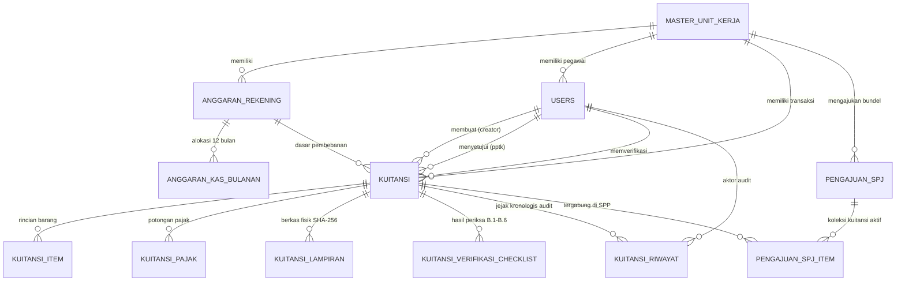

# 📊 Laporan Progres Pengembangan: SI-TALITI v2.0

> **Sistem Informasi Tata Kelola, Asistensi, dan Verifikasi Akuntabilitas SPJ**  
> **Wilayah Implementasi:** Kecamatan Tarogong Kidul & 5 Kelurahan (Kabupaten Garut)  
> **Periode:** Siklus Anggaran Perubahan Tahun 2026  
> **Penyusun:** Antigravity AI & Tim Pengembang SI-TALITI  
> **Status:** ✅ **Phase 1 s.d. Phase 12 SELESAI 100% (Semua Modul Terverifikasi Penuh)**

---

## 1. Ringkasan Eksekutif (Executive Summary)

Pengembangan seluruh arsitektur backend, tata kelola kepatuhan regulasi (*statutory governance*), alur verifikasi dua tingkat (Operator $\rightarrow$ PPTK $\rightarrow$ Verifikator $\rightarrow$ BPP $\rightarrow$ KPA), rekam jejak audit (*Audit Trail* akuntabilitas BPK RI), dasbor analitik real-time, pencetakan berkas dinas offline PDF dengan QR Code, serta pemantauan Service Level Agreement (SLA) 2 hari kerja telah berhasil diselesaikan 100%.

Pengembangan dieksekusi secara disiplin mengikuti prinsip **Test-Driven Development (TDD)**, **Incremental Implementation**, dan **Karpathy Guidelines** (surgical, minimal, non-speculative). Seluruh fungsionalitas sistem telah dibuktikan melalui **98 automated tests (497 assertions) 100% HIJAU (PASS)**, kepatuhan gaya kode PSR-12 melalui Laravel Pint (**119 files clean**), dan kompilasi aset frontend Vite yang bersih tanpa error.

---

## 2. Metrik Kualitas & Performa Sistem

| Indikator | Capaian v1.0 (Phase 1-6) | Capaian v2.0 Final (Phase 1-12) | Keterangan & Dampak Tata Kelola |
| :--- | :---: | :---: | :--- |
| **Total Automated Tests** | 73 Tests (268 Assertions) | **98 Tests (497 Assertions)** | Cakupan pengujian unit, fitur, konsol, PDF, dan API |
| **Durasi Eksekusi Test Suite** | ~2.9 detik | **~4.4 detik** | Eksekusi deterministik cepat via in-memory SQLite |
| **Peran Pengguna (RBAC)** | Terbatas (3 peran) | **5 Peran Resmi Permendagri** | `OPERATOR`, `PPTK`, `VERIFIKATOR`, `BENDAHARA`, `CAMAT` |
| **Alur Otorisasi Belanja** | 1 Tingkat (Operator $\rightarrow$ Verifikator) | **2-Tier Approval Flow** | Menjamin verifikasi berjenjang PPTK sebelum verifikator |
| **Rekam Jejak Audit (BPK)** | Belum ada riwayat mutasi | **Audit Trail Lengkap (Tabel `kuitansi_riwayat`)** | Setiap mutasi status, nilai uang, dan penolakan tercatat |
| **Analitik Dasbor** | Mock data / Statis | **100% Live DB Aggregation** | RAK 12-bulan, breakdown 6 unit kerja, antrean dinamis |
| **Lembar Kendali Verifikasi** | Belum terintegrasi server PDF | **Server-Side Offline PDF + QR Code** | Menggunakan DomPDF & BaconQrCode SVG offline murni |
| **Monitoring SLA Revisi** | Pelacakan lokal | **Stateless SLA + Artisan Scanner** | Perhitungan sisa jam real-time & command `sitaliti:check-sla` |
| **Pagu Anggaran RAK Dikelola** | Rp 14.252.126.458 | **Rp 14.252.126.458 (132 Rekening)** | Tersebar di 6 unit kerja (Kecamatan + 5 Kelurahan) |
| **Kepatuhan Gaya Kode (Pint)** | 0 Warning / Error | **119 File PHP 100% Clean** | Standar PSR-12 Laravel Pint |
| **Build Frontend (Vite)** | - | **0 Error (Built in 1.36s)** | Kesiapan integrasi antarmuka Vue 3 |

---

## 3. Rincian Capaian Komprehensif per Fase Pengembangan

### Phase 1: Statutory Tax Engine (`mod-tax-engine`)
- Menerapkan formula *Zero-Rounding Drift*: $\text{DPP} = \text{round}(\text{Nominal Bruto} / 1.11)$, $\text{PPN} = \text{Nominal Bruto} - \text{DPP}$.
- Kepatuhan PMK 59/2022 (ATK $\le \text{Rp } 2.000.000$ bebas pungut PPN dan PPh 22).
- Kepatuhan UU HKPD 1/2022 (Mamin resto/katering memungut PBJT 10% dan mutlak bebas PPN pusat 11%).
- Kepatuhan PP 80/2010 (PPh 21 Honor ASN berbasis Golongan I-IV).
- Penalti tarif 100% rekanan non-NPWP dan Bea Meterai Rp 10.000 (transaksi $> \text{Rp } 5.000.000$).
- Invarian matematis mutlak: $\text{Nominal Neto} = \text{Nominal Bruto} - \sum \text{Pajak Dipungut}$.

### Phase 2: Budget Reservation Engine (`mod-budget-reservation`)
- Mengelola saldo alokasi kas bulanan RAK 12 bulan dan akumulasi carry-over sisa bulan lalu ($m = 1 \dots n-1$).
- Proteksi penguncian otomatis bulan masa depan ($n > \text{activeMonth}$) berstatus `LOCKED_FUTURE` dengan sisa pagu Rp 0.
- Penolakan nominal $\le 0$ dan pelemparan `PaguOverlimitException` saat saldo tidak mencukupi.
- Proteksi underflow pada saat pelepasan kuncian pagu.

### Phase 3: RAK Master Ledger & High-Speed Streaming Importer (`mod-budget-rak`)
- Impor data hierarki 6 unit kerja, 39 subkegiatan, dan 132 rekening leaf (1.584 baris alokasi bulanan) dari file resmi SIPD-RI.
- Streaming parser native PHP `ZipArchive` & `SimpleXMLElement` (eksekusi 0.2 detik, memori $< 30$ MB).
- Artisan Command `php artisan sitaliti:import-rak`.

### Phase 4: Atomic Receipt Pipeline & SHA-256 Anti-Duplication (`mod-receipt-core`)
- Check constraint integritas database: `CHECK (nominal_neto = nominal_bruto - total_pajak)`.
- Deteksi nota fiktif ganda sinkron instan berbasis hash SHA-256 lampiran kuitansi per rekening belanja (HTTP 422 `DUPLICATE_RECEIPT_ATTACHMENT`).
- Kuncian transaksi atomik (`DB::transaction` & `lockForUpdate`).

### Phase 5: Verification Workspace & SLA Loopback Tracking (`mod-verification-workspace`)
- 35 butir checklist dinamis Form Pembinaan Kecamatan Garut (B.1 ATK, B.2 Mamin, B.3 Honor, B.4 Perjadin, B.5 Jasa, B.6 Modal).
- Transisi status:
  - `VERIFIED`: Berubah ke `LOLOS_VERIFIKASI` dan menghasilkan `qr_token` UUID publik.
  - `REVISION_MINOR`: Tenggat SLA 2 hari kerja efektif (`now()->addWeekdays(2)` melompati akhir pekan).
  - `REVISION_MAJOR`: Otomatis mengembalikan kuncian pagu anggaran.

### Phase 6: Two-Tier Settlement Bundling & Public QR Verification (`mod-settlement-bundling` & `mod-control-sheet-qr`)
- Pembundelan kuitansi lolos verifikasi ke berkas SPP-GU/TU/LS (Tier 2).
- Proteksi anti-klaim ganda ANSI SQL dengan *stored generated column* `active_kuitansi_id` dan unique constraint.
- Fitur *unbundle* kuitansi bermasalah yang mengembalikan status kuitansi ke `LOLOS_VERIFIKASI`.
- Pencatatan SP2D definitif memindahkan pagu terkunci ke realisasi riil via `settleBudget()`.
- Endpoint publik `/verify/{qr_token}` dengan perlindungan privasi data pribadi rekanan (UU PDP).

### Phase 7: RBAC Multi-Peran & Proteksi Batas Otoritas (`mod-rbac-authorization`)
- Mendefinisikan 5 peran resmi: `OPERATOR`, `PPTK`, `VERIFIKATOR`, `BENDAHARA` (BPP), dan `CAMAT` (KPA).
- Middleware `role:...` dan policy otorisasi granular di seluruh endpoint API.
- Proteksi isolasi: Operator hanya dapat mengelola kuitansi unit kerjanya, Verifikator dilarang membuat draf kuitansi, PPTK hanya dapat memvalidasi antrean unitnya.

### Phase 8: Two-Tier Approval Flow (Persetujuan PPTK) (`mod-pptk-workflow`)
- Transisi status terstruktur: `DRAFT` $\rightarrow$ `MENUNGGU_PPTK` $\rightarrow$ `MENUNGGU_VERIFIKASI`.
- Verifikator dilindungi dari memverifikasi kuitansi yang belum disetujui oleh PPTK.
- Penolakan oleh PPTK mengembalikan status kuitansi ke `DRAFT` dan melepaskan pagu yang terkunci.

### Phase 9: Audit Trail & Akuntabilitas BPK RI (`mod-audit-trail`)
- Pembuatan tabel `kuitansi_riwayat` dengan `nullOnDelete` untuk actor user agar audit log abadi jika user dihapus.
- `AuditTrailService` merekam mutasi: pembuatan draf, submit, persetujuan PPTK, lolos verifikasi, revisi minor/mayor, pembundelan SPP, hingga realisasi SP2D.
- Endpoint `GET /api/v1/receipts/{id}/history` menyajikan kronologi lengkap untuk pengawasan Inspektorat dan BPK RI.

### Phase 10: Live Dashboard Analytics (`mod-dashboard-analytics`)
- Menggantikan seluruh data mock dengan kalkulasi SQL agregat langsung:
  - 12 bulan alokasi vs realisasi RAK Kecamatan dan Kelurahan.
  - Distribusi penyerapan anggaran per unit kerja (Kecamatan + 5 Kelurahan).
  - Penghitungan antrean dinamis (`menunggu_pptk`, `menunggu_verifikasi`, `revisi_minor`, `lolos_verifikasi`).
  - Feed aktivitas riil 10 mutasi terakhir dari `kuitansi_riwayat`.

### Phase 11: Server-Side Offline PDF Lembar Kendali (`mod-pdf-generator`)
- Template resmi Form Pembinaan Kecamatan Garut berstandar CSS 2.1 table-based layout via `barryvdh/laravel-dompdf`.
- Penjanaan QR Code verifikasi offline murni berbasis format SVG via `bacon/bacon-qr-code` tanpa bergantung pada koneksi internet pihak ketiga.
- Endpoint pengunduhan berkas PDF `/api/v1/control-sheet/{id}/pdf` dan route web dinas `/control-sheet/{id}/download-pdf`.

### Phase 12: Stateless SLA Monitoring & Alerting (`mod-sla-monitor`)
- Accessor dinamis pada model `Kuitansi`: `is_sla_breached` dan `sla_remaining_hours`.
- Artisan Command `php artisan sitaliti:check-sla` yang dapat dijadwalkan secara periodik (cron job):
  - Memindai kuitansi yang melampaui tenggat revisi 2 hari kerja.
  - Mencatat event `SLA_BREACHED` ke dalam audit trail secara idempoten (tidak terjadi duplikasi).
  - Menyajikan tabel ringkasan konsol bagi administrator sistem.

---

## 4. Diagram Relasi Entitas (ERD) Final

---

## 5. Kesiapan Produksi & Rekomendasi Deployment

1. **Jadwal Task Scheduler (Cron):**
   Tambahkan eksekusi jadwal Laravel di crontab server produksi (`* * * * * cd /path/to/sitaliti-app && php artisan schedule:run >> /dev/null 2>&1`) dan jadwalkan `sitaliti:check-sla` setiap hari kerja pukul 08.00 dan 16.00 WIB.
2. **Kapasitas Penyimpanan Lampiran:**
   Direktori `storage/app/receipts` harus memiliki izin tulis (*write permission*) untuk proses hashing SHA-256 dan upload berkas pendukung.
3. **Kesiapan Frontend:**
   Frontend telah siap dikompilasi dengan `npm run build` dan memanfaatkan panduan integrasi terbaru di [`docs/FRONTEND_INTEGRATION_GUIDE.md`](file:///Users/muhammadabyankamal/proyek/sitaliti/sitaliti-app/docs/FRONTEND_INTEGRATION_GUIDE.md).
